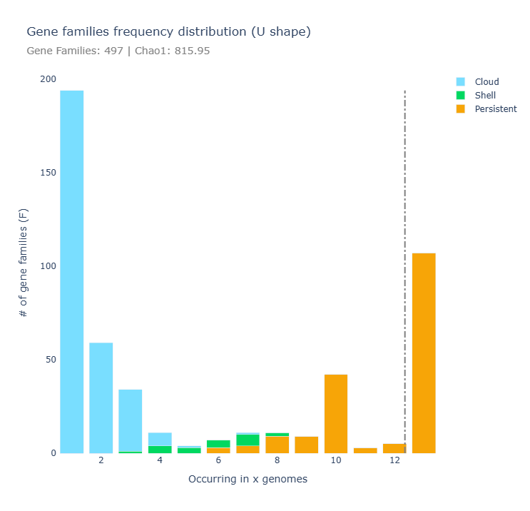
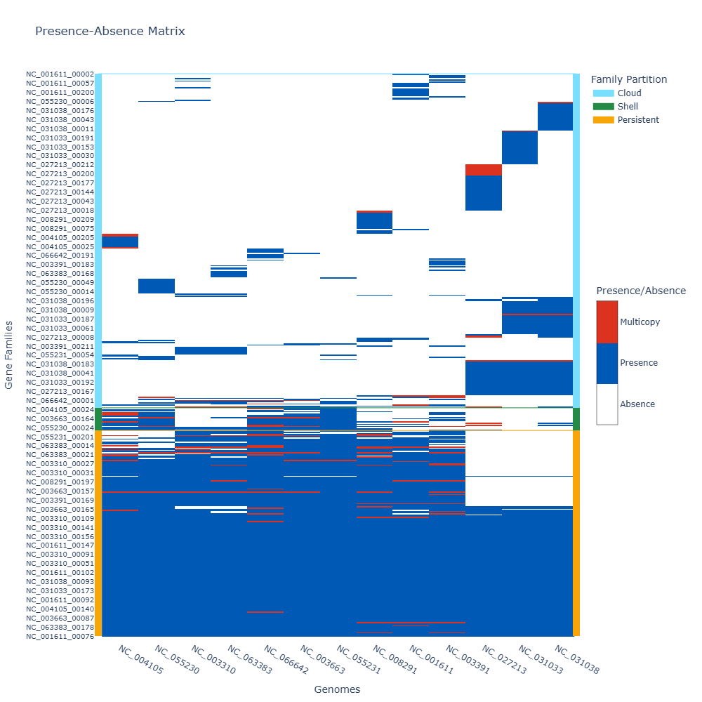

# Orthopoxvirus Pangenomics & Phylogenetics (`orthopoxvirus-pangenomics`)

> **Objective 2** of the B.Sc. (Life Sciences) 4th-Year Dissertation: *"Multi-Scale Genomic Architecture of Monkeypox Virus Human Adaptation: Mutation Hotspots, Structural Variants, and Ortholog Divergence in Sustained-Transmission Lineages"* (Department of Zoology, Deshbandhu College, University of Delhi, 2026).

## Overview

This repository documents the comparative pangenome and evolutionary analysis across **1,525 *Orthopoxvirus* genomes**, integrating **Panaroo** and **PPanGGOLiN** pangenome graph construction with **IQ-TREE** / **IQ-TREE 2** maximum-likelihood phylogenetics, sample metadata classification, core vs. MPXV-specific gene extraction, and accessory/multicopy genome visualization.

## Methodology & Pipeline (`scripts/`)

1. **Pangenome Graph Construction & Phylogeny:**
   * Reconstruct gene families and presence/absence matrices across annotated *Orthopoxvirus* genomes using **Panaroo** and **PPanGGOLiN**.
   * Infer maximum-likelihood evolutionary relationships using **IQ-TREE** / **IQ-TREE 2**.
2. **Metadata Assignment & Gene Set Extraction:**
   * **`scripts/fixmetadata.py`**: Parses sample headers from `panaroo_results/gene_presence_absence.csv` and generates `metadata.csv` (`Sample`, `Group`), labeling isolates matching MPXV accession prefixes (`ON`, `OP`, `OQ`, `NC_063383`, `DQ`, `KJ`) as `MPXV` and remaining isolates as `Other_OPV`.
   * **`scripts/meta.py`**: Combines `metadata.csv` with `panaroo_results/gene_presence_absence.csv` to extract conserved core orthopoxvirus genes (`>= 99%` presence -> `Core_Orthopox_genes.csv`) and MPXV-restricted genes (present in `>= 1` MPXV isolate and absent across all non-MPXV isolates -> `MPXV_specific_genes.csv`).
3. **Accessory & Duplication Visualization:**
   * **`scripts/PresenceAbsence.py`**: Converts `gene_presence_absence.csv` into a binary presence/absence matrix, filters variable accessory/shell loci (`> 1%` and `< 99%` of genomes), and generates `Pangenome_Partition_Plot.png`.
   * **`scripts/plot_multicopy.py`**: Quantifies copy counts per genome across `gene_presence_absence.csv`, isolates multicopy gene families (`> 1` copy), and generates `Pangenome_Multicopy_Plot.png`.

## Key Findings & Results (`results/`)

### Panaroo Pangenome Gene Partition Summary (`summary_statistics.txt`)

| Gene Class | Strain Threshold | Gene Count |
| :--- | :--- | :---: |
| **Core genes** | `99% <= strains <= 100%` | 148 |
| **Soft core genes** | `95% <= strains < 99%` | 25 |
| **Shell genes** | `15% <= strains < 95%` | 39 |
| **Cloud genes** | `0% <= strains < 15%` | 357 |
| **Total genes** | `0% <= strains <= 100%` | **569** |

* **Conserved Core vs. Expansive Cloud:** Across **569** total Panaroo gene clusters, **148** belong to the strict core (`>= 99%` of strains) and **25** to the soft core (`95%` to `< 99%`), whereas **39** fall into the shell (`15%` to `< 95%`) and **357** constitute the cloud genome (`< 15%`), reflecting extensive accessory gene turnover across *Orthopoxvirus* lineages.
* **Presence–Absence / Shell Partition Pattern:** The accessory presence–absence heatmap (`Pangenome_Partition_Plot.png`) visualizes variable gene presence across genomes, highlighting differential retention of accessory loci across lineages.
* **PPanGGOLiN Gene Family Frequency Distribution:** Across **497** gene families (Chao1 richness estimate: **815.95**), the frequency distribution follows a characteristic U-shaped pangenome curve—dominated by **Cloud** families at low genome frequencies and **Persistent** families at high genome frequencies, with **Shell** families occupying intermediate occurrence bins.

### Visual Summary





## Repository Structure

```text
orthopoxvirus-pangenomics/
├── README.md
├── scripts/
│   ├── fixmetadata.py
│   ├── meta.py
│   ├── PresenceAbsence.py
│   └── plot_multicopy.py
└── results/
    ├── summary_statistics.txt
    ├── ppanggolin_u_shape_distribution.png
    └── Pangenome_Partition_Plot.png
